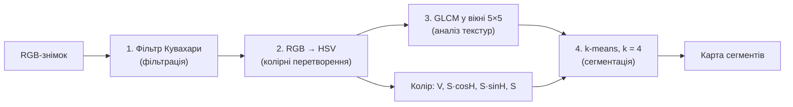
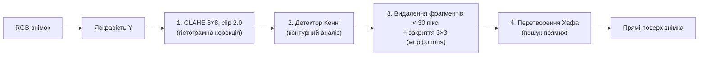

# Опис програми та алгоритмів

## Структура пакета `satimg`

| Модуль | Призначення |
|---|---|
| `io_utils.py` | читання/запис зображень (Pillow лише для I/O), обробка пошкоджених і нестандартних файлів |
| `config.py` | завантаження `config.yaml` і перевизначення параметрів через `--set` |
| `core.py` | базові операції: згортка, гаусове ядро, віконна сума через інтегральне зображення |
| `noise.py` | гаусів та імпульсний шум із фіксованим seed |
| `metrics.py` | MSE, PSNR, SSIM, mIoU, точність сегментації, F1 для контурів |
| `filters.py` | фільтр Кувахари |
| `color.py` | перетворення RGB ↔ HSV |
| `texture.py` | матриця GLCM та ознаки Haralick у ковзному вікні |
| `segmentation.py` | k-means (k-means++, кілька перезапусків) |
| `histogram.py` | гістограма, CLAHE |
| `edges.py` | оператор Собеля, детектор Кенні |
| `morphology.py` | дилатація, ерозія, відкриття, закриття, зв'язні компоненти |
| `hough.py` | перетворення Хафа для прямих, пошук піків, малювання прямих |
| `pipelines.py` | пайплайни №1 і №2, реєстр окремих методів |
| `runner.py` | запуск на вибірці з усіма умовами шуму, збереження стадій і метрик |
| `synthetic.py` | синтетичні еталонні зображення з відомою відповіддю |
| `verify.py` | еталонні сценарії перевірки коректності (C1) |
| `analysis.py` | зведені таблиці, порівняння пайплайнів, графіки, підбір параметрів |
| `cli.py` | інтерфейс командного рядка |

Усі алгоритми обробки реалізовано вручну на NumPy. Бібліотеки комп'ютерного зору
(OpenCV, scikit-image) і методи машинного навчання не використовуються.

## Пайплайн №1 «Текстурна сегментація земного покриву»

1. **Фільтр Кувахари** (вікно 3×3). Для кожного пікселя розглядаються 4 квадранти 2×2,
   що містять піксель. Обирається квадрант з найменшою дисперсією яскравості, і піксель
   отримує його середнє значення. Шум згладжується, межі областей зберігаються.
2. **RGB → HSV.** H = відтінок (0–360°), S = насиченість, V = яскравість. Відтінок —
   кутова величина, тому в ознаки йде як (S·cos H, S·sin H).
3. **GLCM.** Яскравість квантується до 8 рівнів. Для кожного пікселя в вікні 5×5
   рахується симетрична GLCM за 4 напрямками (0°, 45°, 90°, 135°) і чотири ознаки
   Haralick: контраст, енергія, однорідність, ентропія. Оптимізація: замість
   побудови матриці для кожного вікна (65 536 вікон) рахується 64 бінарні карти пар
   рівнів і віконна сума через інтегральне зображення — O(1) на піксель.
4. **k-means.** Вектор ознак пікселя: 4 колірні (усереднені у вікні 5×5) + 4 текстурні,
   z-нормалізовані. Ініціалізація k-means++, 3 перезапуски, обирається розв'язок з
   найменшою сумою квадратів відстаней. Відстані рахуються через |x|² − 2x·c + |c|².

## Пайплайн №2 «Виділення доріг і лінійних структур»

1. **CLAHE.** Знімок ділиться на 8×8 плиток; для кожної — гістограма, обрізана на рівні
   `clip_limit · N / 256`, і функція перетворення через CDF. Значення пікселя —
   білінійна інтерполяція між функціями чотирьох найближчих плиток.
2. **Кенні.** Гаусове згладжування (σ = 1.4) → градієнти Собеля → придушення
   немаксимумів → подвійний поріг (0.1 і 0.25 від максимуму) → гістерезис.
3. **Морфологія.** Зв'язні компоненти (BFS, 8-зв'язність) площею < 30 пікселів
   видаляються (текстура дахів і крон); закриття 3×3 з'єднує розриви.
4. **Хаф.** Акумулятор (ρ, θ), θ ∈ [−90°, 90°) з кроком 1°, ρ з кроком 1 піксель.
   Голоси сусідніх ρ об'єднуються (вікно 3), пік приймається, якщо голосів
   ≥ max(0.75 · менша сторона, 0.4 · максимум); околиця піку 10×10 придушується.

## Як оцінюються результати

Для кожного знімка виконується прогін без шуму (еталон) і з чотирма видами шуму:
гаусів σ = 10, 20, 30 та імпульсний 5 %. Метрики:

| Пайплайн | Метрика | Що показує |
|---|---|---|
| №1 | MSE, PSNR, SSIM після стадії 1 відносно чистого знімка | якість фільтрації |
| №1 | mIoU і точність сегментації відносно сегментації чистого знімка | стійкість до шуму |
| №2 | приріст контрасту CLAHE (відношення std) | ефект стадії 1 |
| №2 | MSE, PSNR, SSIM CLAHE(шум) відносно CLAHE(чистий) | стабільність стадії 1 |
| №2 | F1 контурів відносно контурів чистого знімка (допуск 1 піксель) | стійкість стадій 2–3 |
| №2 | повнота прямих відносно прямих чистого знімка (|Δθ| ≤ 2°, |Δρ| ≤ 3) | стійкість стадії 4 |
| обидва | час обробки | швидкодія |
